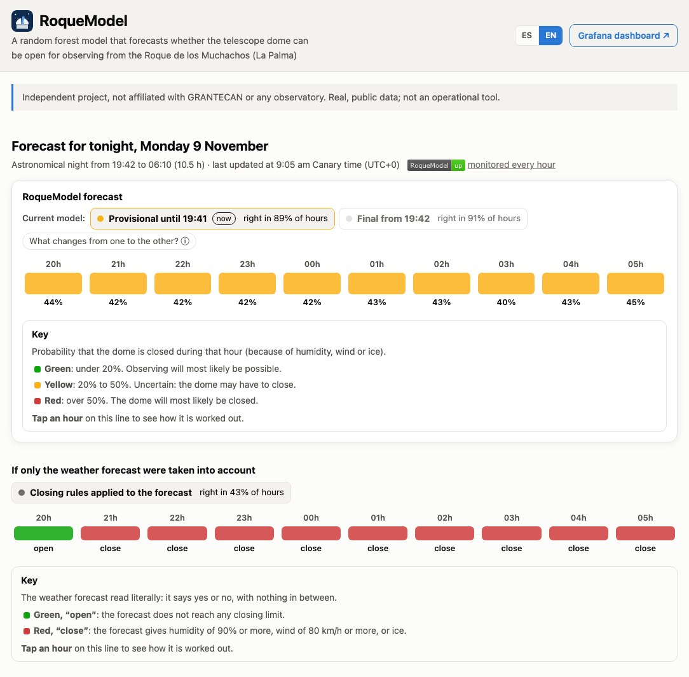

# RoqueModel

**English** · [Español](README.md)

[](https://github.com/saimonx/roque-model/actions/workflows/tests.yml)
[](docs/TECHNICAL_DETAILS.md#7-how-each-hour-works)

A random forest model that forecasts whether the telescope dome can be open for observing from the Roque de los
Muchachos (La Palma).

It updates every hour and gives, for each hour of the night, the probability that the dome must close because of
humidity, wind or ice. It learns from weather forecasts archived since 2017 and from what the summit weather station
actually measured.

- **Website, updated every hour:** https://saimonx.github.io/roque-model/?lang=en (in English and Spanish; the full
  explanation of the model is in its sections)
- **Public Grafana dashboard:** https://saimonx.github.io/roque-model/grafana/en/ (reads from FIWARE, where the
  forecast is published every hour: Orion and QuantumLeap on the project's own server)
- **Live FIWARE**, the two public endpoints Grafana reads from (JSON, read only):
  - [Tonight's forecast (Orion)](https://178-105-253-255.sslip.io/orion/v2/entities/urn:ngsi-ld:WeatherForecast:ORM-tonight?options=keyValues)
  - [Latest NOT weather station measurements (QuantumLeap)](https://178-105-253-255.sslip.io/ql/v2/entities/urn:ngsi-ld:WeatherObserved:ORM-NOT?lastN=200)
- **Training data:** [roquemodel_data.zip](https://github.com/saimonx/roque-model/releases/download/training-data/roquemodel_data.zip)
  (30,044 night hours with their label and inputs, and the answers of the tested copy)
- **Technical details:** [docs/TECHNICAL_DETAILS.md](docs/TECHNICAL_DETAILS.md)

> **Independent project.** It is not affiliated with, endorsed by or made for GRANTECAN, the IAC, the ING, the NOT,
> the TNG, the Liverpool Telescope or any other institution. All data are real and public, and cited below.



## How it works

1. **Every hour** it downloads the latest weather forecast, the NOT weather station measurements and last night's
   seeing.
2. **It builds 33 inputs for each hour of the night:** the forecast for that hour and for the whole night, the summit
   station in the 2 hours before the night, what happened last night and the time of year.
3. **It computes a percentage:** a random forest (150 decision trees, scikit-learn) gives the probability that the
   dome is closed in each hour.

**Hourly monitoring:** an independent check reviews the website, FIWARE, the Grafana dashboard, GitHub and the server;
it fixes what it can and sends an email alert if something fails (badge above). Forecast errors reach Sentry with
their full trace. Details in [docs/TECHNICAL_DETAILS.md](docs/TECHNICAL_DETAILS.md#7-how-each-hour-works).

There are two versions: the **provisional** one, before the night starts, without the summit station, and the
**final** one, from the start of the night, with all the data.

**What counts as closed** (rebuilt from the NOT weather station's minute-by-minute measurements): humidity ≥ 90% or
wind ≥ 80 km/h (it reopens after 20 consecutive minutes below), or ice (≤ 0 °C with 90% humidity in the previous
24 h). Compared with the Liverpool Telescope night reports, this label agrees on 87 of every 100 nights (2017–2026).

## How accurate it is

Copy trained on 2017–2023 and tested on 2024–2026, years it had not seen (8,577 night hours):

| | Right (hours open or closed) |
|---|---|
| **RoqueModel, final** | **91%** |
| RoqueModel, provisional | 89% |
| Weather forecast alone (close if any limit is exceeded) | 43% |

The forecast alone closes too often because it looks at a lower, more humid point than the summit: it gives 6,111
closed hours when there were 1,453. RoqueModel gives 1,390. The live model was retrained with the same settings on all
of 2017–2026.

## Data

| Used for | Source | Since |
|---|---|---|
| What happened (label) | [NOT weather archive](https://www.not.iac.es/weather/archive/met/index.php), every minute | 1997 (used from 2017) |
| What was known before the night | ECMWF forecasts archived by [Open-Meteo](https://open-meteo.com) ([CC BY 4.0](https://creativecommons.org/licenses/by/4.0/)) | 2017 |
| Wind at summit height | NOAA GFS at 750 hPa, archived by Open-Meteo | 2021 |
| Last night's seeing | [ING R2D2 monitor](https://astro.ing.iac.es/seeing/) | 2018 |
| Checking the label | [Liverpool Telescope night reports](https://telescope.livjm.ac.uk/Reports/) | 2007 |

## Getting started

Requires [uv](https://docs.astral.sh/uv/) (it installs Python 3.13 if needed).

```bash
uv sync                                       # creates .venv and installs the dependencies
.venv/bin/python -m pytest                    # runs the tests
.venv/bin/python -m roque_forecast.tonight    # tonight's forecast -> site/data/tonight.json
.venv/bin/python -m roque_forecast.site_data  # accuracy figures -> site/data/evaluation.json
.venv/bin/python -m http.server 8765 -d site  # open http://localhost:8765
```

To download the history again and retrain, see [all the commands](docs/TECHNICAL_DETAILS.md#9-all-the-commands).

## What is in the repository

| Folder | Contents |
|---|---|
| `src/roque_forecast/` | Python code: data download, label, models, live forecast, FIWARE and Grafana |
| `site/` | the website (HTML, CSS and JavaScript without libraries) |
| `notebooks/`, `reports/` | analysis of the data and of the models |
| `infra/` | FIWARE (Orion, QuantumLeap, CrateDB) with Docker: locally with Grafana, and in production behind HTTPS (`infra/cloud/`) |
| `.github/workflows/` | the hourly forecast on GitHub Actions |
| `tests/` | tests with small real files |

## References

- [Abárzuza et al. 2025, RNAAS 9(2)](https://doi.org/10.3847/2515-5172/adb14f): a random forest predicts seeing at the Roque from weather station data.
- [de Sepibus, Masciadri et al. 2026, arXiv:2607.12900](https://arxiv.org/abs/2607.12900): persistence and precasting as the minimum baselines a forecast must beat.
- [Lombardi et al. 2007, arXiv:astro-ph/0702570](https://arxiv.org/abs/astro-ph/0702570): wind and humidity versus seeing at the Roque.
- [ING, INT telescope alarm procedure](https://www.ing.iac.es/Astronomy/tonotes/int/observer/old/alert.html): close at 90% humidity and with gusts above 80 km/h.
- [NOT weather station](https://www.not.iac.es/weather/): humidity closing rule (90%, reopens after 20 minutes below).
- [Breiman 2001, Machine Learning 45](https://doi.org/10.1023/A:1010933404324): the original random forest paper.
- [Grinsztajn, Oyallon and Varoquaux 2022, NeurIPS](https://arxiv.org/abs/2207.08815): why tree-based models still beat neural networks on tabular data.
- [Hollmann et al. 2025, Nature 637](https://pubmed.ncbi.nlm.nih.gov/39780007/): TabPFN, a pretrained model for small tables.
- [Masciadri et al. 2016, SPIE 9909](https://arxiv.org/abs/1608.06506): operational forecasting of optical turbulence with the Meso-NH model for large telescopes.
- [Masciadri et al. 2024, SPIE 13097](https://arxiv.org/abs/2409.05133): FATE, the automatic optical-turbulence forecast system of the VLT (ESO, Paranal).
- [Mommert 2020, AJ 159](https://arxiv.org/abs/2003.11109): cloud detection in all-sky camera images with machine learning.
