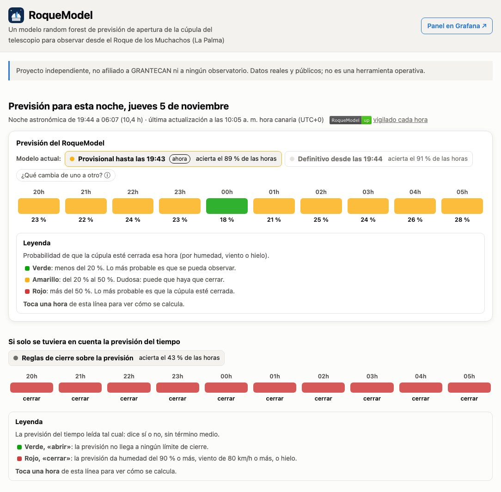

# RoqueModel

[](https://github.com/saimonx/roque-model/actions/workflows/tests.yml)
[](docs/DETALLES_TECNICOS.md#7-cómo-funciona-cada-hora)

Un modelo de previsión de apertura de la cúpula del telescopio para observar desde el Roque de los Muchachos
(La Palma).

Se actualiza cada hora y da, para cada hora de la noche, la probabilidad de que haya que cerrar la cúpula por humedad,
viento o hielo. Aprende de las previsiones del tiempo archivadas desde 2017 y de lo que midió de verdad la
estación de la cumbre.

- **Web, actualizada cada hora:** https://saimonx.github.io/roque-model/ (la explicación completa del modelo
  está en sus apartados)
- **Panel público de Grafana:** https://saimonx.github.io/roque-model/grafana/ (lee de FIWARE, donde el pronóstico se
  publica cada hora: Orion y QuantumLeap en un servidor propio)
- **Datos de entrenamiento:** [roquemodel_data.zip](https://github.com/saimonx/roque-model/releases/download/training-data/roquemodel_data.zip)
  (30.044 horas de noche con su etiqueta y sus datos de entrada, y las respuestas de la copia probada)
- **Detalles técnicos:** [docs/DETALLES_TECNICOS.md](docs/DETALLES_TECNICOS.md)

> **Proyecto independiente.** No está afiliado, respaldado ni hecho por encargo de GRANTECAN, el IAC, el ING,
> el NOT, el TNG, el Telescopio Liverpool ni ninguna otra institución. Todos los datos son reales y públicos,
> y se citan abajo.



## Cómo funciona

1. **Cada hora** descarga la previsión del tiempo más reciente, lo que mide la estación del NOT y el seeing
   de anoche.
2. **Monta 33 datos para cada hora de la noche:** la previsión de esa hora y de toda la noche, la estación de
   la cumbre en las 2 horas antes de la noche, lo que pasó anoche y la época del año.
3. **Calcula un porcentaje:** un random forest (150 árboles de decisión, scikit-learn) da la probabilidad de
   cúpula cerrada en cada hora.

**Vigilancia cada hora:** una comprobación independiente revisa la web, FIWARE, el panel de Grafana, GitHub y el
servidor; arregla lo que puede y avisa por correo si algo falla (insignia de arriba). Los errores del pronóstico
llegan a Sentry con su traza completa. Detalles en
[docs/DETALLES_TECNICOS.md](docs/DETALLES_TECNICOS.md#7-cómo-funciona-cada-hora).

Hay dos versiones: la **provisional**, antes de que empiece la noche, sin la estación de la cumbre, y la
**definitiva**, desde que empieza la noche, con todos los datos.

**Qué cuenta como cerrada** (reconstruido minuto a minuto con la estación del NOT desde 1997): humedad ≥ 90 %
o viento ≥ 80 km/h (reabre tras 20 minutos seguidos por debajo), o hielo (≤ 0 °C con humedad del 90 % en las
24 h anteriores). Comparada con los partes del Telescopio Liverpool, esta etiqueta coincide en 87 de cada 100
noches (2017–2026).

## Cuánto acierta

Copia entrenada con 2017–2023 y probada en 2024–2026, años que no había visto (8.577 horas de noche):

| | Acierta (horas abierta o cerrada) |
|---|---|
| **RoqueModel, definitivo** | **91 %** |
| RoqueModel, provisional | 89 % |
| Decir siempre «abierta» | 83 % |
| Solo la previsión del tiempo (cerrar si pasa algún límite) | 43 % |

La previsión sola cierra de más porque mira un punto más bajo y húmedo que la cumbre: da 6.111 horas
cerradas cuando fueron 1.453. RoqueModel da 1.390. El modelo en directo se ha vuelto a entrenar con los
mismos ajustes con todo 2017–2026.

## Datos

| Para qué | Fuente | Desde |
|---|---|---|
| Lo que pasó (etiqueta) | [Archivo meteorológico del NOT](https://www.not.iac.es/weather/archive/met/index.php), minuto a minuto | 1997 |
| Lo que se sabía antes de la noche | Previsiones ECMWF archivadas por [Open-Meteo](https://open-meteo.com) ([CC BY 4.0](https://creativecommons.org/licenses/by/4.0/)) | 2017 |
| Viento a la altura de la cumbre | NOAA GFS a 750 hPa, archivado por Open-Meteo | 2021 |
| Seeing de anoche | [Monitor R2D2 del ING](https://astro.ing.iac.es/seeing/) | 2018 |
| Comprobar la etiqueta | [Partes nocturnos del Telescopio Liverpool](https://telescope.livjm.ac.uk/Reports/) | 2007 |

## Ponerlo en marcha

Necesita [uv](https://docs.astral.sh/uv/) (instala Python 3.13 si hace falta).

```bash
uv sync                                       # crea .venv e instala las dependencias
.venv/bin/python -m pytest                    # ejecuta los tests
.venv/bin/python -m roque_forecast.tonight    # pronóstico de esta noche -> site/data/tonight.json
.venv/bin/python -m roque_forecast.site_data  # cifras de acierto -> site/data/evaluation.json
.venv/bin/python -m http.server 8765 -d site  # abre http://localhost:8765
```

Para volver a descargar el histórico y entrenar, ver [todos los comandos](docs/DETALLES_TECNICOS.md#9-todos-los-comandos).

## Qué hay en el repositorio

| Carpeta | Contenido |
|---|---|
| `src/roque_forecast/` | código en Python: descarga de datos, etiqueta, modelos, pronóstico en directo, FIWARE y Grafana |
| `site/` | la web (HTML, CSS y JavaScript sin librerías) |
| `notebooks/`, `reports/` | análisis de los datos y de los modelos |
| `infra/` | FIWARE (Orion, QuantumLeap, CrateDB) con Docker: en local con Grafana, y en producción detrás de HTTPS (`infra/cloud/`) |
| `.github/workflows/` | el pronóstico de cada hora en GitHub Actions |
| `tests/` | tests con ficheros reales pequeños |

## Referencias

- Breiman 2001, *Machine Learning* 45, [doi:10.1023/A:1010933404324](https://doi.org/10.1023/A:1010933404324) — random forest.
- Abárzuza et al. 2025, *RNAAS* 9(2), [doi:10.3847/2515-5172/adb14f](https://doi.org/10.3847/2515-5172/adb14f) — random forest que predice el seeing del Roque con la estación meteorológica.
- de Sepibus, Masciadri et al. 2026, [arXiv:2607.12900](https://arxiv.org/abs/2607.12900) — persistencia y «precasting» como referencias mínimas.
- Lombardi et al. 2007, [arXiv:astro-ph/0702570](https://arxiv.org/abs/astro-ph/0702570) — viento y humedad frente al seeing en el Roque.
