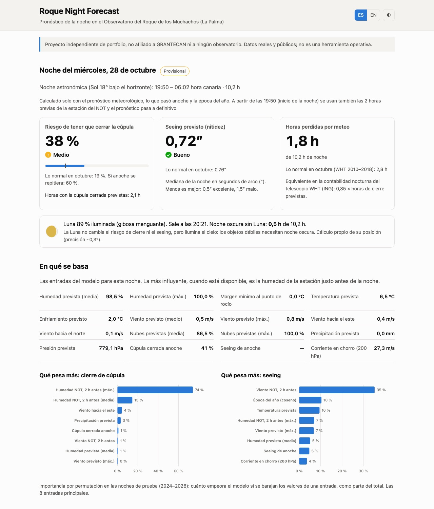
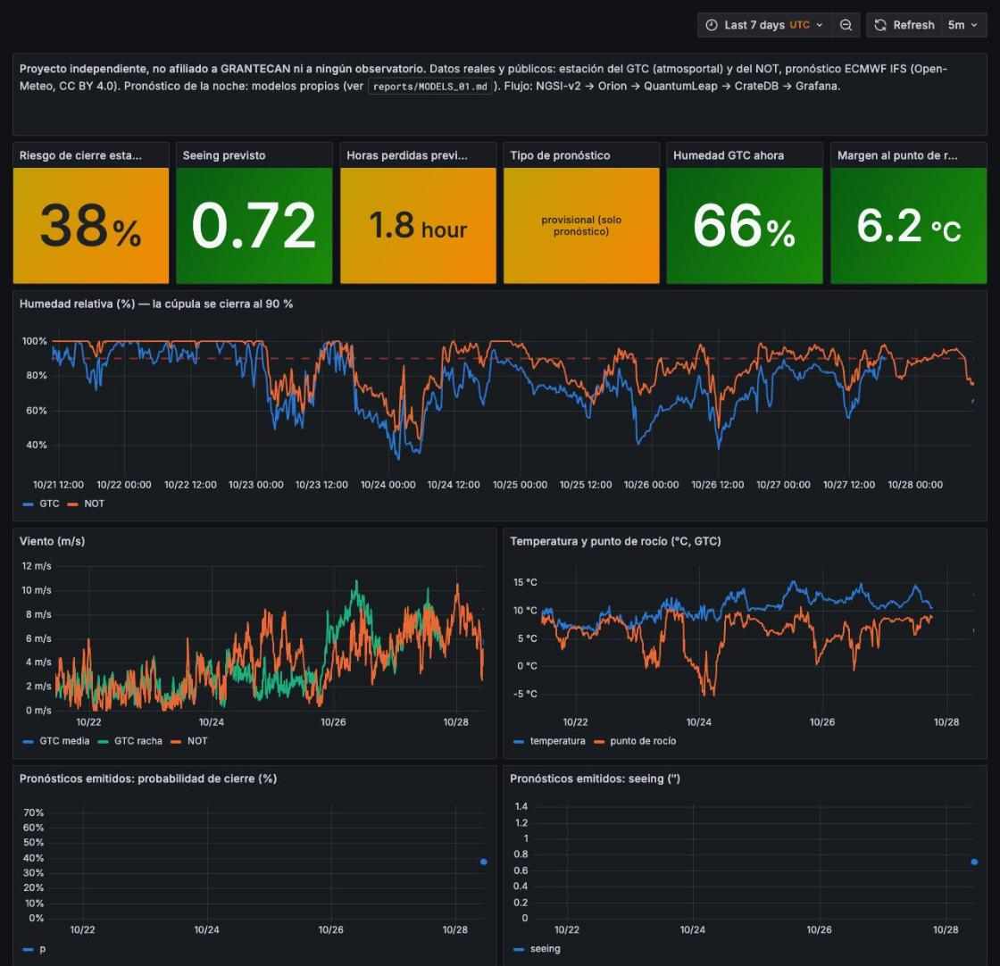

# Roque Night Forecast

Tonight at the **Roque de los Muchachos Observatory** (La Palma, Canary Islands), hour by hour: **will the
dome be open, and how sharp will the stars be?**

> **Independent project.** This is a personal portfolio project. It is **not affiliated with,
> endorsed by or produced for** GRANTECAN, the IAC, the ING, the NOT, the TNG, the Liverpool Telescope or
> any other institution. All data come from their public web pages and are credited below.



## What it forecasts: two models, one label checked against a telescope

| Question | Forecast | Learnt from |
|---|---|---|
| **Will the dome be open, and when?** | For each night hour, the probability that the dome is closed (`hourly.py`). The night's expected closed hours are the sum of the hours. | The **closure label** (see [below](#when-the-dome-counts-as-closed)), rebuilt minute by minute from the NOT weather station since 1997 (`dome.py`). |
| **How sharp?** | The median seeing of the night (`train.py`). | The ING R2D2 seeing monitor (2018 →). |

The Moon (phase, rise/set, moonless hours) is computed, not forecast.

**Why a model and not the weather forecast itself?** The weather model sees the mountain lower than it is,
inside the sea of clouds below the summit: read literally (humidity ≥ 90 % → close) it calls "close" in
most night hours, and in 2024–2026 only 2 in 10 of those calls were right. The models learn, from 7 years of
archived forecasts against what happened at the summit, how to correct it.

### When the dome counts as closed

Measured minute by minute by the NOT weather station at the summit. The dome counts as closed if any of
these is true (`dome.py`):

| Reason | Closes when | Reopens when | Where the value comes from |
|---|---|---|---|
| Humidity | humidity reaches **90 %** | it has been below 90 % for **20 minutes in a row** | NOT telescope closing rule |
| Wind | wind reaches **80 km/h** (22.2 m/s) | it has been below for **20 minutes in a row** | INT telescope closing limit (ING alert procedure) |
| Ice | temperature ≤ **0 °C** and humidity reached 90 % in the previous **24 h** | temperature rises above 0 °C | Our rule, tuned on Liverpool Telescope reports 2017–2022 (adds 29 nights; the LT lost 26 of them) |

An hour counts as closed if the dome is closed for at least 30 of its 60 minutes. Cloud and dust are not
included: there is no reliable public summit record of them for every year.

### Is the label real?

There is no public record of when the GTC closes, so the label is compared with **one real telescope for
every year**: the **Liverpool Telescope** (robotic 2 m on the same mountain), which books every night since
2007 how many hours it lost to the weather (`validate.py`). Both are asked the same question, night by
night: **was at least half of the night lost?**

- They **agree on 87 of every 100 nights** (3,322 nights, 2017–2026).
- When the label says the night was lost (529 nights), the LT lost it too **96 times in 100**.
- When the label keeps the dome open all night (2,458 nights), the LT did not lose the night either
  **90 times in 100**.
- The LT loses more nights than the label (909 against 529): it also closes for cloud, dust or caution,
  and the label only measures humidity, wind and ice.

| Year | Nights | Agree (of 100) | Lost by the label | Lost by the LT | Lost by both |
|---|---|---|---|---|---|
| 2026 | 273 | 92 | 48 | 69 | 47 |
| 2025 | 317 | 87 | 52 | 94 | 52 |
| 2024 | 314 | 85 | 45 | 83 | 41 |
| 2023 | 316 | 88 | 61 | 94 | 59 |
| 2022 | 346 | 90 | 66 | 97 | 65 |
| 2021 | 357 | 72 | 51 | 148 | 50 |
| 2020 | 350 | 86 | 56 | 100 | 54 |
| 2019 | 341 | 93 | 34 | 51 | 31 |
| 2018 | 358 | 92 | 75 | 95 | 70 |
| 2017 | 350 | 87 | 41 | 78 | 37 |

For specialists: correlation between the LT hours lost and the label's closed hours 0.74.

**Why only one source?** So the check means the same thing every year. Not used: the GTC public archive
(exposure times show when the GTC was open, but data become public one year later and only 2024–2025 were
available), the TNG weather downtime (only the last year is published) and the WHT accounting (some years
book nights with the dome closed as observed).

## Results (test years 2024–2026, never used for training or for any choice)

**Hour by hour, against what really happened** (8,577 night hours; "close" = forecast humidity ≥ 90 %, or
model probability ≥ 50 %):

| | Hours with the dome closed | Wrong in | Closes when not needed | Stays open when it should close |
|---|---|---|---|---|
| What really happened (measured at the summit) | 1,453 h | — | — | — |
| Weather forecast alone | 6,111 h | 57 of every 100 hours | 4,756 h | 98 h |
| **Our model (final)** | **1,432 h** | **9 of every 100 hours** | 380 h | 401 h |
| Our model (provisional) | 1,411 h | 13 of every 100 hours | 515 h | 557 h |

Saying "open" every hour would be wrong in 17 of every 100 hours (the closed ones), so the model beats that
floor too.


| Forecast | Simplest references | Our forecast (final) |
|---|---|---|
| Dome closed, each hour (8,577 hours) | raw forecast: right 2 in 10 "close" calls; humidity just before the night: right 7 in 10 | **right 7 in 10, catches 7 in 10**; Brier 0.067 (skill 0.51), AUC 0.95 |
| Closed hours of the night (1,028 nights) | usual for the month: off by 2.0 h; same as last night: 1.3 h; raw forecast: 4.7 h | **off by 0.8 h on average** (provisional, before the night: 1.1 h) |
| Seeing of the night (780 nights) | usual for the month: off by 0.23″; same as last night: 0.28″ | **off by 0.20″** (RMSE 0.284″ against 0.350″) |

Two modes, so a forecast never uses information it could not have had: **provisional** (afternoon:
weather forecast, last night, season) and **final** (from the start of astronomical night, adding the NOT
station in the 2 hours before the night, the input that helps the most).

**Tried and dropped** (documented in [MODELS_01](reports/MODELS_01.md)): separate nightly closure and WHT
hours-lost models (replaced by the hourly model and its sum), Liverpool hours-lost and clear-sky models (no
better than "same as last night" for the sky), a CAMS dust warning (too few events), hour-by-hour seeing
(no better than the nightly model) and isotonic recalibration (no gain).

## Data

All data are **real and public**; nothing in this project is simulated.

| Use | Source | Period |
|---|---|---|
| Label (what happened) | [NOT weather archive](https://www.not.iac.es/weather/archive/met/index.php), minute by minute: humidity, wind, temperature, pressure | 1997 → today |
| Label (what happened) | [ING R2D2 seeing monitor](https://astro.ing.iac.es/seeing/) | Sep 2018 → today |
| Inputs (what was known) | [Open-Meteo](https://open-meteo.com) archived ECMWF IFS HRES forecasts ([CC BY 4.0](https://creativecommons.org/licenses/by/4.0/)), as issued at the time | 2017 → today |
| Inputs (what was known) | Open-Meteo archived NOAA GFS: wind at 750 hPa (summit height) and 200 hPa (jet stream) | Mar 2021 → today |
| Checking the label | [Liverpool Telescope night reports](https://telescope.livjm.ac.uk/Reports/): hours lost to weather per night | 2007 → today |
| Nightly study only | [ING nightly accounting](https://a.ing.iac.es/weather/archive/) (WHT hours lost) | 2007 → today |
| Live, shown only | [GTC atmosportal](https://atmosportal.gtc.iac.es/) panel; [TNG weather](https://tngweb.tng.iac.es/weather) (stored for later) | live |

Downloads identify themselves with a descriptive User-Agent, wait between requests and only use pages
linked from the public sites.

## Status

| Step | State |
|---|---|
| Downloaders, bulk history, clean tables, EDA — [report](reports/EDA_01.md), [notebook](notebooks/01_eda.ipynb) | done |
| Nightly study (closure, seeing, WHT hours lost) — [report](reports/MODELS_01.md), [notebook](notebooks/02_models.ipynb) | done |
| Closure label with humidity, wind and ice; hourly closure model; checks against GTC, LT and WHT | done |
| Tonight's forecast, live, every hour; FIWARE entities + Grafana (ES/EN) | done (local) |
| Bilingual web page | done (local); GitHub Pages when the repo is public |

## Key findings from the data

- A closure rule rebuilt from humidity alone tracks the hours the WHT really lost to weather (r = 0.74 in 2007–2018) but misses winter losses; adding strong wind and ice to the label closes most of that gap (see the checks above).
- The WHT accounting is not equally reliable every year: since 2019 many nights with the domes closed by humidity are reported as fully observed with zero losses. Those years (2019–2022, 2024–2025) are kept out of model fitting and shown only for comparison.
- Wind is the strongest driver of seeing (Spearman +0.58 with the night's maximum wind); easterly winds give the worst seeing.
- For seeing, the monthly climatology (RMSE 0.34″) beats "same as last night" (0.41″): that is the bar a model must clear.


## Scientific references
- Abárzuza et al. 2025, *RNAAS* 9(2), [doi:10.3847/2515-5172/adb14f](https://doi.org/10.3847/2515-5172/adb14f) — random forest predicting seeing at the Roque from weather-station data.
- de Sepibus, Masciadri et al. 2026, [arXiv:2607.12900](https://arxiv.org/abs/2607.12900) — persistence and "precasting" as minimum baselines for seeing forecasts.
- Lombardi et al. 2007, [arXiv:astro-ph/0702570](https://arxiv.org/abs/astro-ph/0702570) — wind and humidity vs. seeing at the Roque.

## Quick start

Requires [uv](https://docs.astral.sh/uv/) (it installs Python 3.13 if needed).

```bash
uv sync                                          # create .venv and install dependencies
.venv/bin/python -m pytest                       # run the tests
.venv/bin/python -m roque_forecast.backfill not  # historical download (also: r2d2, ing); resumable
.venv/bin/python -m roque_forecast.build_tables  # raw files -> data/processed/*.parquet
.venv/bin/python -m roque_forecast.backfill forecasts  # archived Open-Meteo forecasts (~30 s)
.venv/bin/python -m roque_forecast.features      # one row per night: inputs known at sunset + labels
.venv/bin/python -m roque_forecast.train         # fit, compare with baselines -> reports/results/
.venv/bin/python -m roque_forecast.hourly        # hourly closure model -> reports/results/hourly_scores.csv
.venv/bin/python -m roque_forecast.backfill liverpool    # Liverpool Telescope night reports (2007 -> today)
.venv/bin/python -m roque_forecast.validate      # label checks -> reports/results/validation.json
```

### Tonight's forecast and the web page

```bash
.venv/bin/python -m roque_forecast.tonight      # live data + models -> site/data/tonight.json
.venv/bin/python -m roque_forecast.site_data    # evaluation + live track record -> site/data/evaluation.json
.venv/bin/python -m http.server 8765 -d site    # open http://localhost:8765 (?lang=es or ?lang=en)
scripts/update_tonight.sh                       # both steps (hourly job); ROQUE_PUBLISH=1 also publishes
```

The page answers the question first (how many hours should be observable, and which), with two lines of
hours: **our model** (probability, green / orange / red) and **the weather forecast alone** (the label's
rules read literally: close / open), each with its historical accuracy against what really closed. Clicking
an hour shows how both come out: for the model, a starting point plus the amount each group of inputs adds
or takes away: this hour's forecast humidity, wind, temperature, cloud, rain and pressure one by one, then
the night forecast, the summit station, last night and the time of year (exact Shapley values over ten
groups, `explain.py`); for the forecast, which rule is met.
Then the seeing and the Moon; the evidence (label checks, scores in plain words, recent nights, reliability, live track
record, technical scores) is folded below.

Every run is logged in `data/forecasts/issued.jsonl`. Each run also records what really happened the
night before (`outcomes.jsonl`), so the page builds a **live track record**, scoring the first final
forecast of each night.

`scripts/publish_site.sh` force-pushes `site/` to a `gh-pages` branch as a single commit, so hourly
updates never pile up in the history of `main`.

### FIWARE + Grafana (local, Docker)

```bash
docker compose -f infra/docker-compose.yml up -d     # Orion :1027, QuantumLeap :8669, Grafana :3001
.venv/bin/python -m roque_forecast.fiware provision  # subscription Orion -> QuantumLeap (once)
.venv/bin/python -m roque_forecast.fiware backfill   # optional: last 30 days of both stations
.venv/bin/python -m roque_forecast.dashboards        # regenerate the ES and EN dashboards
```

| Entity | Type ([Smart Data Models](https://github.com/smart-data-models/dataModel.Weather)) | Updated by |
|---|---|---|
| `urn:ngsi-ld:WeatherObserved:ORM-GTC` | `WeatherObserved` | `collect live` (every 15 min) |
| `urn:ngsi-ld:WeatherObserved:ORM-NOT` | `WeatherObserved` | `tonight` (hourly) |
| `urn:ngsi-ld:WeatherForecast:ORM-tonight` | `WeatherForecast` (+ closed hours, hourly closure probability, seeing) | `tonight` (hourly) |



Ports are shifted by one from the FIWARE defaults, so the stack can run next to another FIWARE stack.
If Docker is not running, the forecast and the collectors carry on and skip this step.

### Collectors (macOS)

```bash
scripts/install_collectors.sh               # install the 3 LaunchAgents
scripts/install_collectors.sh --uninstall   # remove them
```

| Agent | When | What |
|---|---|---|
| `live` | every 15 min | GTC live panel + TNG current values → `data/raw/live/YYYY-MM/YYYY-MM-DD.jsonl` |
| `daily` | 10:07 and 22:07 | TNG last-24 h series + downtime → `data/raw/tng/YYYY-MM-DD/` |
| `weekly` | Monday 10:23 | GTC last-30-days series → `data/raw/gtc_atmosportal/YYYY-MM-DD/` |
| `tonight` (installed separately: `install_collectors.sh tonight`) | every hour at :05 | `scripts/update_tonight.sh` |

## Layout

```
src/roque_forecast/
  config.py          site coordinates, folders, polite-download settings
  polite_http.py     shared HTTP client (User-Agent, delay, retries)
  collect.py         command-line collector (live / daily / weekly / sample)
  backfill.py        resumable bulk download of the historical archives
  build_tables.py    raw files -> clean Parquet tables (minutes, R2D2 points, ING nights, nights)
  astro.py           Sun altitude and astronomical night (NOAA formulas, checked against ING)
  dome.py            closure label rebuilt minute by minute: humidity, strong wind, ice
  features.py        modelling table: forecast + pre-night station + persistence + season, and labels
  train.py           nightly models: seeing (used live), closure and WHT hours (study only)
  hourly.py          hourly closure model, provisional and final, against baselines
  explain.py         why each hour gets its percentage: starting point + one amount per group of inputs
  validate.py        checks the label against the Liverpool Telescope night reports, year by year
  plotting.py        shared figure style (colour-blind-safe palette)
  tonight.py         tonight's forecast from live data (provisional / final modes)
  site_data.py       evaluation and live track record for the web page
  fiware.py          NGSI-v2 entities, Orion updates, QuantumLeap subscription and backfill
  dashboards.py      Grafana dashboards (Spanish and English) from one definition
  sources/           one module per data source: download + parse
site/                static bilingual web page (index.html, assets/; data/ is generated)
infra/               Docker Compose for Orion, QuantumLeap, CrateDB and Grafana
scripts/             LaunchAgent installer, hourly update and gh-pages publishing
notebooks/           analysis notebooks (.py source + executed .ipynb)
reports/             written findings, figures and metric tables (reports/results/)
tests/               parser tests on small real files (tests/fixtures/), time-window and split tests
launchd/             LaunchAgent templates
data/                downloaded data (not in git)
```
