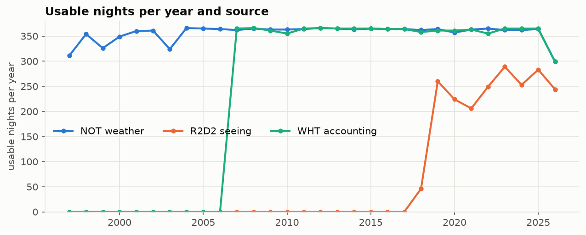
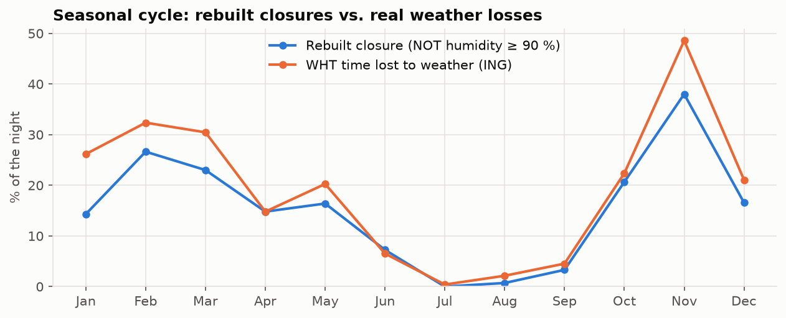
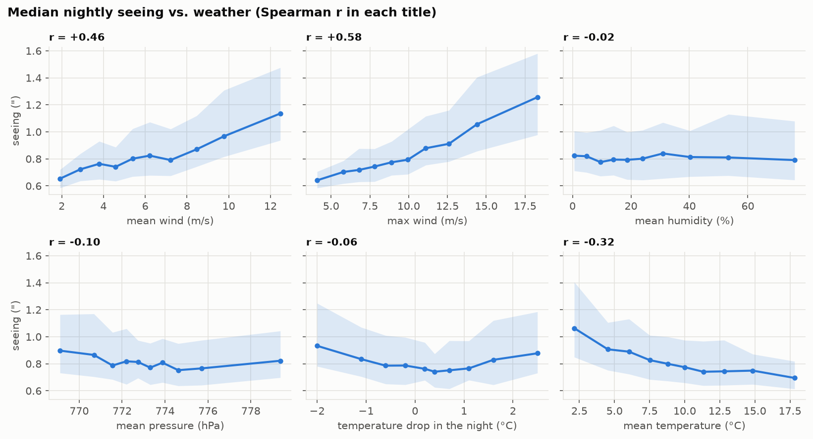
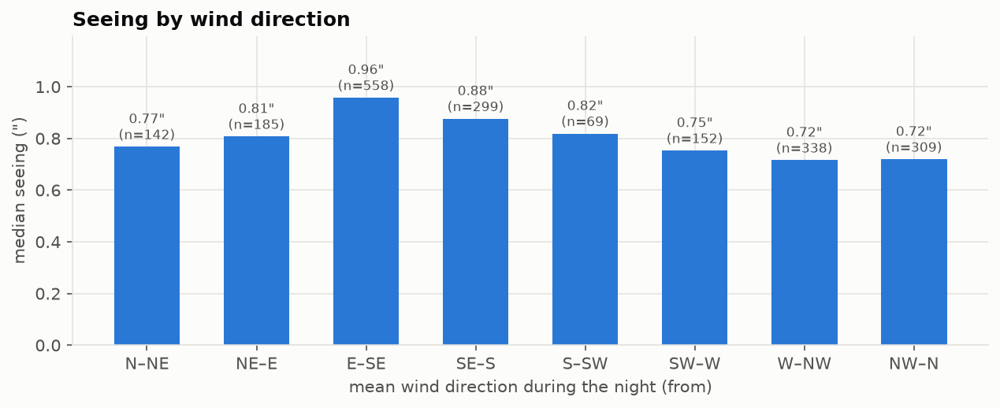
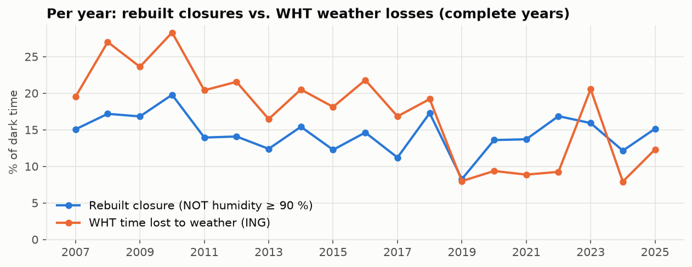

**English** · [Español](EDA_01.md)

# EDA 01: observing conditions on the Roque de los Muchachos

> **Earlier study (27–28 Oct 2026), kept as it was.** The current model (RoqueModel, a random forest that
> forecasts each hour of the night) and its results are in [docs/TECHNICAL_DETAILS.md](../docs/TECHNICAL_DETAILS.md)
> and on the [website](https://saimonx.github.io/roque-model/).

Independent project, not affiliated with GRANTECAN or any observatory. Only real public data (see the README).
Full analysis and code: [`notebooks/01_eda.ipynb`](../notebooks/01_eda.ipynb).

> **Status (28 Oct 2026):** the three historical sources are complete: NOT meteorology (1997–2026),
> R2D2 seeing (2018–2026) and the WHT night log published by the ING (2007–2026, 7,239 night pages).

## Data

| Source | Usable nights | Period |
|---|---|---|
| NOT meteorology, ≥ 80% of the night covered | 10,682 | Feb 1997 → today (every 5 min until 2006, every minute since 2007) |
| R2D2 seeing, ≥ 40 values in the night | 2,054 | Sep 2018 → today |
| WHT night log (ING), with real accounting on the page | 7,193 | Jan 2007 → today |

Each night is labelled with the date on which it starts, and only the **astronomical night** (Sun below −18°) is used.
Our twilight times match the ING's to the minute.

## 1. The dome closure rule reconstructed from humidity works

The NOT's public export does not include rain or dome indicators, so closure was reconstructed from humidity
(close at ≥ 90%, reopen after 20 min below). Compared with the hours the WHT actually lost to weather:

- **Correlation 0.64** night by night over 7,156 nights (**0.74 in 2007–2018**; section 4 explains why the later
  years give less); **90%** agreement on "more than half the night was lost".
- The seasonal cycle matches: almost nothing lost in July and August, the worst in winter. Over the 30 full years of NOT
  data, the reconstructed closure covers **0.4%** of the night in July and **23–28%** from November to January.
- The rule **falls short on winter losses**. The WHT lost most of 274 nights with less than 10%
  reconstructed closure; their median maximum humidity is only 43% and their median maximum wind, 10 m/s. They point to other
  causes (wind, dust/calima, snow and ice on the domes, clouds with dry air). These are the additional inputs the
  closure model needs.

## 2. Seeing

- Median of the nightly medians: **0.81″** (25–75%: 0.67″–1.04″), close to the 0.77″ published for the TNG in
  2017–2024 (de Sepibus, Masciadri et al. 2026).
- **Wind is the strongest single factor:** Spearman r = +0.58 with the night's maximum wind and +0.46 with the mean.
  The median seeing goes from ~0.65″ on calm nights to ~1.2″ in strong wind. This agrees with Abárzuza et al. 2025, where
  the maximum 1-minute wind gust was the most important variable.
- **Cold nights are worse** (r = −0.32 with mean temperature), mostly as a winter effect.
- Humidity on its own has hardly any influence on seeing (r ≈ 0); pressure and the night's cooling have weak effects.
- **Wind direction:** easterly winds (E–SE, 0.96″) are clearly worse than westerly and northerly ones (0.72″), which
  fits with air arriving over the caldera and the island's ridge rather than from the open sea.

## 3. The baselines any model has to beat

| Target | Corr(tonight, last night) | Persistence RMSE | Monthly climatology RMSE |
|---|---|---|---|
| Night's median seeing (″) | 0.37 | 0.41 | **0.34** |
| Reconstructed closure (fraction of the night) | 0.55 | 0.31 | 0.31 |
| WHT time lost to weather (fraction) | 0.48 | 0.33 | 0.31 |

- For **seeing**, "same as last night" is *worse* than "the typical value for this month". Seeing changes a lot from one night to the next,
  so the bar is climatology (RMSE 0.34″) and, within the night, *precasting* (the value from the last hour).
- For **closures**, persistence and climatology are equally good: bad weather comes in spells of several days. A useful
  model has to predict when a spell starts and ends, and that requires the weather **forecast**, not just
  past observations.

## 4. Label quality: the WHT night log is not equally reliable every year

In **2019–2022 and 2024–2025** the WHT reports roughly half the weather losses of other years (8–12% of
night time versus 16–28%), while the humidity-based closure stays at its usual 12–17%. A real change
in the weather would move both lines.

The night log pages explain it: on many nights the WHT reports **the whole night as observed, with no weather,
technical or other losses**, even though the NOT humidity kept the domes closed for at least 80% of the night.
They look like unfilled reports, not real observing (part of that period coincides with the WHT's refit for the
WEAVE instrument; the cause is not publicly documented).

| Period | Nights closed ≥ 80% (NOT) | …of which the WHT says "all observed" |
|---|---|---|
| 2007–2018 | 453 | 62 (14%) |
| 2019–2026 | 276 | 156 (57%) |

The night-by-night correlation drops from **0.74** (2007–2018) to **0.46** (2019–2026).

**Consequence for modelling:** the WHT losses can only be used as a training label after removing the
218 suspicious nights (or the affected years). This decision is made explicitly in the modelling step and reported,
never hidden.

## Next steps

Done in the modelling step ([MODELS_01.en.md](MODELS_01.en.md)). The WHT losses are only fitted with years of reliable records
(2017, 2018, 2023) and tested on 2026; 2019–2022 and 2024–2025 are shown for comparison only.
