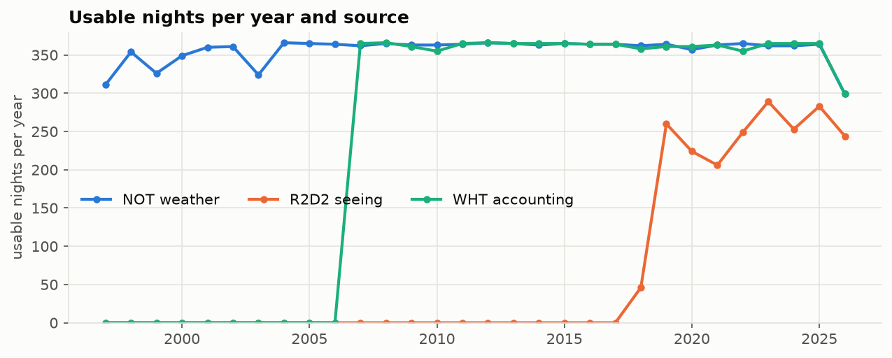
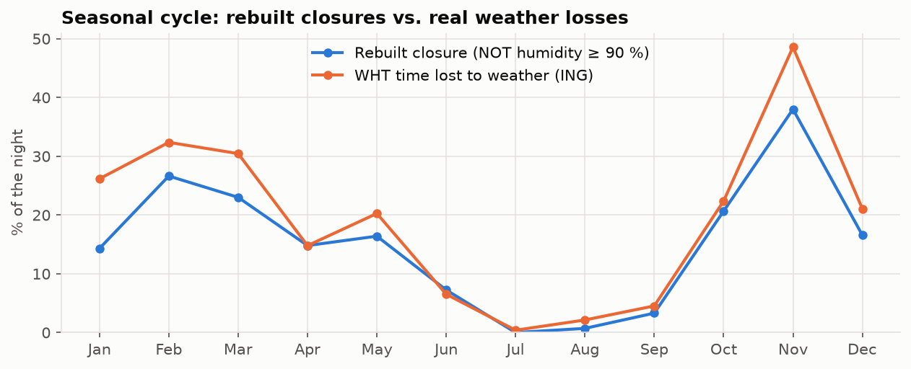
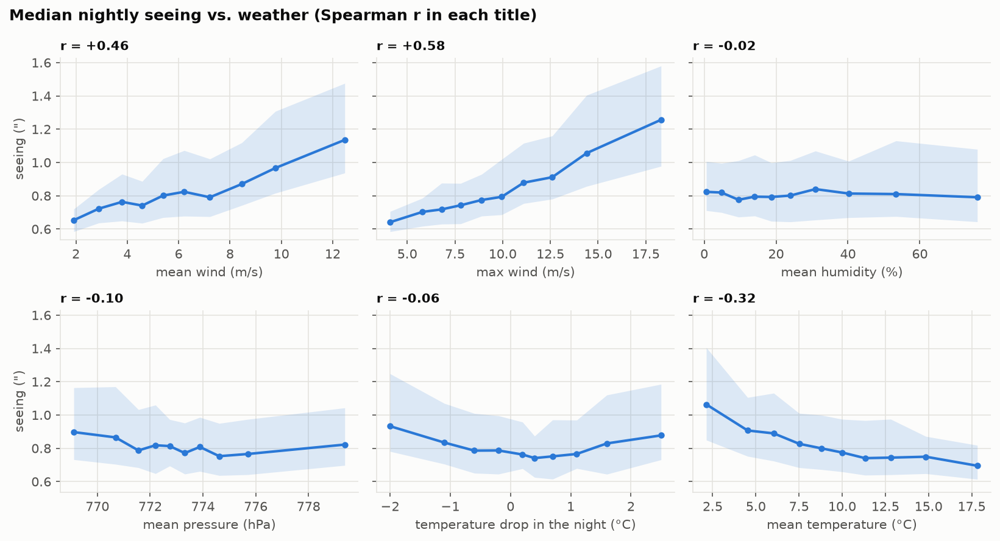
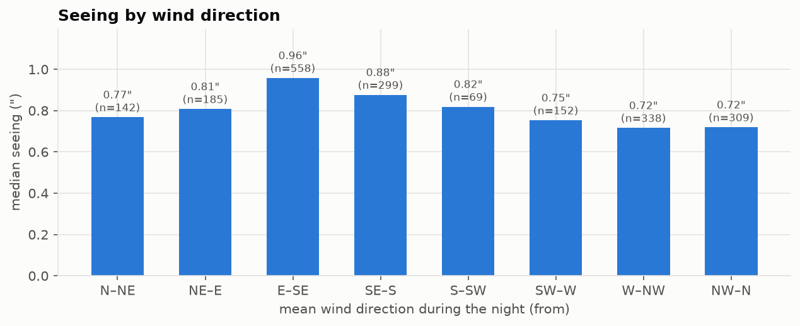
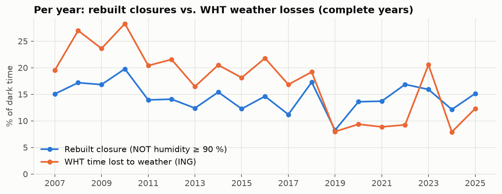

# EDA 01 — Observing conditions at the Roque de los Muchachos

> **Previous study (27–28 Oct 2026), kept as it was.** The current model (RoqueModel, a random forest that
> forecasts each night hour) and its scores are in [docs/DETALLES_TECNICOS.md](../docs/DETALLES_TECNICOS.md)
> (in Spanish) and on the [web page](https://saimonx.github.io/roque-model/).

Independent project, not affiliated with GRANTECAN or any observatory. Real public data only (see README).
Full analysis and code: [`notebooks/01_eda.ipynb`](../notebooks/01_eda.ipynb).

> **Status (28 Oct 2026):** all three historical sources are complete: NOT weather (1997–2026),
> R2D2 seeing (2018–2026) and the ING nightly accounting of the WHT (2007–2026, 7,239 night pages).

## Data

| Source | Nights usable | Period |
|---|---|---|
| NOT weather, ≥ 80 % of the night covered | 10,682 | Feb 1997 → today (5-min sampling until 2006, 1 min from 2007) |
| R2D2 seeing, ≥ 40 values in the night | 2,054 | Sep 2018 → today |
| WHT accounting (ING), real accounting on the page | 7,193 | Jan 2007 → today |

A night is labelled with the date on which it starts and only **astronomical night** (Sun below −18°) is
used. Our twilight times match the ING's to the minute.

## 1. The dome-closure rule rebuilt from humidity works

The NOT public export has no rain or dome flags, so the closure was rebuilt from humidity
(close at ≥ 90 %, reopen after 20 min below). Compared with the hours the WHT really lost to weather:

- **Correlation 0.64** night by night over 7,156 nights (**0.74 for 2007–2018**, see section 4 for why
  later years are weaker); **90 %** agreement on "more than half of the night lost".
- The seasonal cycle matches: almost nothing lost in July–August, worst in winter. Over the full 30 years of
  NOT data the rebuilt closure takes **0.4 %** of the night in July and **23–28 %** from November to January.
- The rule **under-estimates winter losses**. 274 nights were mostly lost by the WHT with less than 10 %
  rebuilt closure; their median maximum humidity is only 43 % and their median maximum wind 10 m/s.
  They point to other causes (wind, dust/calima, snow and ice on the domes, cloud over dry air). These
  are the extra inputs the closure model needs.

## 2. Seeing

- Median of nightly medians **0.81″** (25–75 %: 0.67″–1.04″), close to the 0.77″ reported for the TNG
  2017–2024 (de Sepibus, Masciadri et al. 2026).
- **Wind is the strongest single driver:** Spearman r = +0.58 with the night's maximum wind and +0.46
  with the mean. Median seeing goes from ~0.65″ in calm nights to ~1.2″ with strong wind. This agrees
  with Abárzuza et al. 2025, where the 1-min maximum wind gust was the most important variable.
- **Cold nights are worse** (r = −0.32 with mean temperature), largely a winter effect.
- Humidity alone barely matters for seeing (r ≈ 0); pressure and the night's cooling have weak effects.
- **Wind direction:** easterly winds (E–SE, 0.96″) are clearly worse than westerly and northerly winds
  (0.72″), consistent with air arriving over the island's caldera and ridge instead of the open ocean.

## 3. The baselines any model must beat

| Target | Corr(tonight, last night) | Persistence RMSE | Monthly-climatology RMSE |
|---|---|---|---|
| Nightly median seeing (″) | 0.37 | 0.41 | **0.34** |
| Rebuilt closure (fraction of night) | 0.55 | 0.31 | 0.31 |
| WHT weather lost (fraction) | 0.48 | 0.33 | 0.31 |

- For **seeing**, "same as last night" is *worse* than "typical value for this month". Seeing changes a
  lot from night to night, so the bar to beat is climatology (RMSE 0.34″), and within the night,
  *precasting* (last hour's value).
- For **closures**, persistence and climatology are equally good: bad weather comes in spells lasting
  several days. A useful model has to predict when a spell starts and ends, which needs the weather
  **forecast**, not only past observations.

## 4. Label quality: the WHT accounting is not equally reliable every year

In **2019–2022 and 2024–2025** the WHT reports about half the weather losses of other years (8–12 % of
dark time against 16–28 %), while the humidity-based closure stays at its usual 12–17 %. A real change in
the weather would move both lines.

The accounting pages explain it: on many nights the WHT reports the **whole night as observed, with zero
weather, technical or other losses**, although NOT humidity kept the domes closed for at least 80 % of
the night. Those nights look like missing reports, not real observing (part of that period coincides
with the WHT being adapted for the WEAVE instrument; the cause is not documented publicly).

| Period | Nights closed ≥ 80 % (NOT) | …of which WHT says "all observed" |
|---|---|---|
| 2007–2018 | 453 | 62 (14 %) |
| 2019–2026 | 276 | 156 (57 %) |

Night-by-night correlation drops from **0.74** (2007–2018) to **0.46** (2019–2026).

**Consequence for modelling:** the WHT losses can be used as a training label only after removing the
218 suspect nights (or the affected years). This choice is made explicitly in the modelling step and
reported, never hidden.

## Next steps
Done in the modelling step ([MODELS_01.md](MODELS_01.md)). The WHT losses are fitted only on years
with a reliable log (2017, 2018, 2023) and tested on 2026; 2019–2022 and 2024–2025 are shown for
comparison only.
