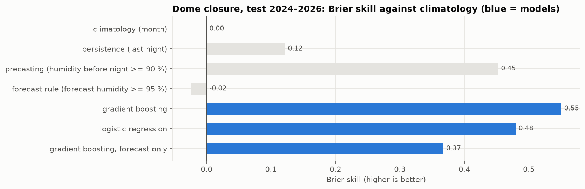

**English** · [Español](MODELS_01.md)

# Models 01: tonight's forecast on the Roque de los Muchachos

> **Earlier study (28–31 Oct 2026), kept as it was.** Sections 1–3 are the per-night models that were built
> first (gradient boosting, WHT lost hours); section 4 is the first version of the hourly model. The
> current model (RoqueModel, a random forest that forecasts each hour of the night) and its results are in
> [docs/TECHNICAL_DETAILS.md](../docs/TECHNICAL_DETAILS.md) and on the
> [website](https://saimonx.github.io/roque-model/?lang=en).

> **Independent project**, not affiliated with GRANTECAN or any observatory. All data are real and public.
> Notebook: [`notebooks/02_models.ipynb`](../notebooks/02_models.ipynb). Code: `src/roque_forecast/features.py`,
> `src/roque_forecast/train.py`, `hourly.py`, `validate.py`. Metrics: [`reports/results/`](results/).

## The question

At the start of the night, using only what is known at that moment:
1. **Will the dome have to be closed?** The label is that the NOT humidity rule (≥ 90%, reopen after 20 min
   below) closes it for at least 1 hour. This happens on roughly 1 night in 5.
2. **What will the seeing be like?** The label is the night's median R2D2 DIMM seeing.
3. **How many hours will be lost to weather?** The label is the WHT night log.

## Inputs (all available before the night starts)

| Group | Inputs | Source |
|---|---|---|
| Night forecast | humidity (mean, maximum), dew point depression, temperature and its drop, wind (mean, maximum, east-west and north-south components), cloud cover, precipitation, pressure | ECMWF IFS HRES 9 km via the [Open-Meteo](https://open-meteo.com) forecast archives (CC BY 4.0) |
| Station before the night | humidity (mean, maximum), wind and pressure in the 2 h before astronomical night | NOT weather archive |
| Persistence | closure fraction and median seeing from last night | NOT, R2D2 |
| Time of year | sine and cosine of the day of the year | — |

What makes the evaluation honest is using real forecasts, not the measured weather. Two archives are used:
- **Training and main test:** the first hours of each model run, since 2017. They are somewhat *better* than the
  afternoon forecast.
- **Check:** the forecasts issued 24 h earlier, since 2025. They are somewhat *worse* than the afternoon forecast.

The real skill lies between the two results.

## Method

- **Time-based split:** train on 2017–2022 (2,191 nights), choose settings with 2023 (365), test on 2024–Oct 2026
  (1,031). The test years were not used for any choice.
- **Models:** gradient boosting (scikit-learn's `HistGradientBoosting`; a 2×2×2 grid chosen with 2023), with a
  linear or logistic regression as a simpler alternative. Seeing is modelled on a logarithmic scale.
- **Baseline methods:** each is turned into a probability using only the training years.
  - climatology: the usual value for the month;
  - persistence: same as last night;
  - precasting: the station conditions just before the night;
  - for closure only, a simple rule on the forecast humidity.

## Results in the test years (2024–2026)

### 1. Dome closure (1,025 nights)

| Method | Brier ↓ | Brier skill vs climatology ↑ | AUC ↑ | Closures flagged | False alarms |
|---|---|---|---|---|---|
| Climatology (month) | 0.149 | 0 | 0.70 | — | — |
| Persistence (last night) | 0.131 | 0.12 | 0.72 | 56% | 44% |
| Precasting (humidity ≥ 90% before the night) | 0.082 | 0.45 | 0.83 | 71% | 17% |
| Rule on the forecast (forecast humidity ≥ 95%) | 0.153 | −0.02 | 0.64 | — | — |
| **Gradient boosting** | **0.067** | **0.55** | **0.96** | **79%** | 25% |
| Logistic regression | 0.078 | 0.48 | 0.95 | 78% | 27% |
| Gradient boosting, forecast only | 0.094 | 0.37 | 0.91 | 68% | 33% |

- **Best model:** gradient boosting reduces the Brier score by 18% compared with the best baseline (precasting).
- **Forecasts from 24 hours earlier** (398 nights in 2025–2026): skill 0.56, versus 0.44 for precasting. The result
  holds when the forecast is older.
- **Strongest input:** the station humidity just before the night. The model refines that reading with the forecast wind and
  precipitation.
- **Forecast only:** without the station readings (for example, to plan tomorrow night) the forecast is still
  much better than climatology or persistence. It does not reach precasting.
- **Calibration:** probabilities between 40% and 90% are somewhat high (reliability diagram in the notebook).

### 2. Seeing (780 nights with R2D2 data)

| Method | RMSE (″) ↓ | MAE (″) ↓ | RMSE skill vs climatology ↑ |
|---|---|---|---|
| Climatology (month) | 0.350 | 0.227 | 0 |
| Persistence (last night) | 0.415 | 0.278 | −0.19 |
| **Gradient boosting** (with jet-stream wind) | **0.284** | **0.197** | **0.19** |
| Gradient boosting, without jet-stream wind | 0.286 | 0.198 | 0.18 |
| Linear regression (log) | 0.288 | 0.202 | 0.18 |
| Gradient boosting, forecast only | 0.310 | 0.219 | 0.11 |

- **Forecasts from 24 hours earlier:** 0.303″ versus 0.378″ for climatology (skill 0.20).
- **Jet-stream wind (added on 28 Oct 2026).** Turbulence aloft blurs the stars even when
  it is calm at ground level. The ECMWF archive has no pressure levels, so the 200 hPa (~12 km) wind comes from the
  NOAA GFS archive, which starts in March 2021; earlier nights have no value (gradient boosting handles missing values
  natively). It was accepted using the validation year only (RMSE 0.347″ → 0.340″ in 2023). In the test years the
  improvement is small but holds in both archives (0.286″ → 0.284″; 24 h old: 0.306″ → 0.303″). The
  dome models do not use it.
- **Strongest input:** the station wind before the night, followed by temperature and time of year.
  This agrees with Abárzuza et al. 2025.
- **Limit:** a linear model is almost as good. Almost all the turbulence is in layers that the ground station
  cannot see, so the remaining error is large.

### 3. Hours lost to weather (WHT)

**Why a calibration line.** Only three years combine a forecast archive with a reliable WHT record:
2017, 2018 and 2023. Section 4 of the EDA explains which years are reliable. Those three years are too few for a model of their own.
Instead, the forecast of closed hours is converted with a single factor fitted on those years:
`lost = 0.85 × forecast closed hours`.

- The forecast hours used in the fit come from models that had not seen that year ("out of fold").
- A free intercept was rejected using those same years, before looking at 2026. It added 0.6 h to every clear night.

| Test set | Method | RMSE (h) ↓ | MAE (h) ↓ |
|---|---|---|---|
| **2026** (reliable, 299 nights) | Climatology (month, 2010–2018) | 2.99 | 2.09 |
| | Persistence (last night) | 3.23 | 1.42 |
| | **Calibrated closure forecast** | **2.65** | **1.36** |
| 2024–2025 (doubtful record, for comparison only) | Climatology | 2.65 | 2.09 |
| | Persistence | 2.87 | 1.21 |
| | Calibrated closure forecast | 2.93 | 1.55 |

- **2026:** the forecast beats both baselines on both measures.
- **2024–2025:** it does not beat them, because in those years the record counts many closed nights as observed. The model gets
  the weather right and the label does not. That is why those years are excluded from the fit.

## 4. The design used live (28 Oct 2026): one closure label, one hourly model, three checks

Sections 1–3 study the night as a whole. The live product is simpler and is the one to read:

| Question | Model | Label |
|---|---|---|
| Is the dome closed this hour? | RoqueModel, a random forest per night hour (`hourly.py`; model and settings from `compare.py`), provisional and final | `dome.closed`: humidity ≥ 90% (reopen after 20 min), **or** gusts ≥ 22.2 m/s (80 km/h, the INT limit, same reopening), **or** ice (≤ 0 °C with humidity ≥ 90% in the previous 24 h) |
| How many closed hours tonight? | sum of the hourly probabilities | the same label, summed over the whole night |
| Night's seeing | section 2 (`train.py`) | R2D2 median |

**The ice rule** was calibrated with the Liverpool Telescope reports for 2017–2022 (never the test years): it adds
29 nights to the label, and the LT lost 26 of them.

**Hourly slots:** UTC hours with ≥ 30 minutes of astronomical night (32,153 hours, 2017–2026). An hour is labelled
closed when the label covers at least half of it, and only if ≥ 45 minutes were measured. Inputs: the ECMWF forecast at the middle
of the hour (the 10 m wind is no use at the summit, mean 1.3 m/s, so the GFS 750 hPa wind is added from
2021), the per-night inputs from section 1 and the position of the hour within the night.

### Results in the test years (2024–2026)

Hour by hour against what actually happened (`site_data.comparison`): the dome was closed for 1,453 of 8,577 hours. Taken
at face value, the weather forecast would close 6,111 hours and is wrong in 56.6% of hours (4,756 unnecessary closures,
98 missed); the final model flags 1,390 hours and is wrong in 8.9% (351 / 414); the provisional one, in
11.5%.

| Dome closed, each hour (8,577 hours, 17% closed) | Brier ↓ | Skill | AUC | Right when it says "closed" | Closed hours detected |
|---|---|---|---|---|---|
| Climatology (month) | 0.136 | 0 | 0.66 | — | — |
| Forecast at face value | 0.566 | −3.16 | 0.63 | 22% | 93% |
| Persistence (same hour last night) | 0.120 | 0.12 | 0.69 | 52% | 47% |
| Precasting (humidity before the night) | 0.081 | 0.41 | 0.85 | 67% | 77% |
| Model, provisional | 0.084 | 0.38 | 0.91 | 69% | 59% |
| **Model, final** | **0.063** | **0.54** | **0.95** | **75%** | **72%** |

| Closed hours in the night (1,028 nights) | MAE | RMSE |
|---|---|---|
| Climatology (month) | 1.95 h | 2.87 h |
| Persistence (last night) | 1.33 h | 2.94 h |
| Forecast at face value | 4.67 h | 5.93 h |
| Model, provisional | 1.24 h | 2.06 h |
| **Model, final** | **0.87 h** | **1.68 h** |

The provisional model loses to precasting hour by hour: precasting already uses the station just before the night, something
the provisional model cannot have. Once the night starts, the final model uses it too and beats all the baselines.

### Does the label reflect reality? (`validate.py`, `results/validation.json`)

Checked against **a single source for all years**, so that the check means the same thing every year: the
**Liverpool Telescope** night reports (2017–2026, 3,322 nights with a report). Both are asked, night by night, whether
at least half the night was lost:

- They agree on 87.2% of nights (72–93% depending on the year; the lowest, 2021, when the LT lost 148 nights, including
  cloud and dust).
- Label "lost" (529 nights) → the LT also lost it in 95.7% of cases. Label open all night (2,458) → the LT
  kept the night in 89.9% of cases.
- The LT lost 909 nights and the label 529: the LT also closes for cloud, dust and as a precaution.
- Correlation of the hours: 0.74; mean of 2.75 h lost by the LT versus 1.61 h closed according to the label.

Sources studied and not used, because they do not cover all years in the same way:
- **Public GTC archive** (CAB): science exposure times show when the GTC was definitely open
  (Jan 2024 – Sep 2025: 1,499 h exposing, label "closed" in 0.8% of those minutes), but the data become public
  a year later and the archive cannot show closures.
- **TNG time lost to weather:** only the last 365 days are published (Oct 2025 – Oct 2026: correlation 0.90).
- **WHT night log:** some years count nights with the dome closed as observed (EDA, section 4).

### Live models retrained on 2017–2026 (31 Oct 2026)

The results above come from models trained on 2017–2023 and tested on 2024–2026. Once measured, the live
RoqueModel (final and provisional) is retrained with the same settings on all labelled years, 2017–2026
(30,044 hours, 5,163 closed). Before doing so: training on 2017–2023 versus 2017–2024 with the same settings and
measuring on 2025–2026, the extra year improved the Brier score from 0.0655 to 0.0622 (final) and from 0.0879 to 0.0847 (provisional).
The live record keeps measuring the retrained models on the new nights.

### Model choice: random forest (31 Oct 2026, `compare.py`)

Gradient boosting (162 combinations) and random forest (288) had equally broad settings searches over the
validation years 2021–2023; logistic regression and an MLP, smaller ones. Validation Brier, final / provisional: gradient
boosting 0.0594 / 0.0856, random forest 0.0595 / 0.0869 (by year they alternate: final 0.0516 / 0.0559 / 0.0708 versus
0.0521 / 0.0568 / 0.0695). Within 2%, so the test decides: random forest 0.0628 / 0.0839 versus 0.0667 / 0.0859
(accuracy 91.1% / 88.5% versus 90.7% / 88.2%). That choice looked at the test years, so those results may be
somewhat optimistic. Nightly totals: MAE 0.87 h versus 0.77 h (worse), RMSE 1.68 h versus 1.75 h (better).

### Tried and discarded

- Separate per-night closure and WHT hours models in the live product (sections 1 and 3): replaced by the sum
  of the hourly model, which answers both with a single label.
- Hour-by-hour seeing: RMSE 0.358″ versus 0.409″ for climatology, but no better than the per-night model for the night as a
  whole, and the hourly R2D2 label is very noisy.
- Separate humidity and wind models combined as `1 − (1 − p_h)(1 − p_w)`: same Brier score as a model with the composite
  label, so the single label was kept.
- Liverpool Telescope lost-hours and photometric-sky models: the LT label mixes reasons the GTC does not
  share (it closes earlier), and the photometric model barely beat persistence (Brier skill 0.17 versus 0.12). The
  LT reports are kept only as a check.
- CAMS dust warning: 18 dust nights in the test years, CAMS archive only since August 2022, 93% false
  alarms.

## Limitations and next steps

- **Approximate labels.** The closure label is reconstructed from the NOT weather station (humidity, wind, ice). Closures
  for dust and cloud are not in it, and none of the labels is an operational decision by the GTC itself (section 4
  checks them).
- **A forecast model at one grid point.** The point is 4 km away, over smoothed terrain, and is usually more humid
  and calmer than the summit. The model learns to correct for it.
- **Closure recalibration, tried and rejected (28 Oct 2026).** Isotonic regression was checked without touching the test
  years: "out of fold" probabilities for each year of 2017–2023 (model trained on the other six) and then a
  nested fit of the isotonic curve leaving one year out each time. Brier 0.0517 without recalibration versus 0.0521 recalibrated (forecast-only
  model: 0.0922 versus 0.0933), so it is not applied. The check runs at every training
  (`train.calibration_check`, saved in `results/settings.json`). In the test years the model is somewhat overconfident between
  40% and 90%; with ~250 nights in those ranges this may be noise or a change in the climate of recent years, and it is in the
  live record that it has to be watched.
- **Possible improvements:** a longer archive of pressure-level forecasts for the jet stream (training currently
  only has it from 2021).
