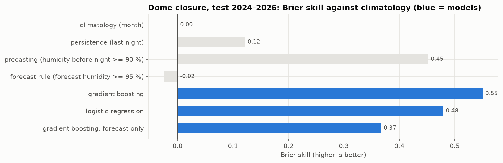

# Models 01 — Forecasting tonight at the Roque de los Muchachos

> **Previous study (28–31 Oct 2026), kept as it was.** Sections 1–3 are the nightly models that came first
> (gradient boosting, WHT hours lost); section 4 is the first version of the hourly model. The current model
> (RoqueModel, a random forest that forecasts each night hour) and its scores are in
> [docs/DETALLES_TECNICOS.md](../docs/DETALLES_TECNICOS.md) (in Spanish) and on the
> [web page](https://saimonx.github.io/roque-model/).

> **Independent project**, not affiliated with GRANTECAN or any observatory. All data are real and public.
> Notebook: [`notebooks/02_models.ipynb`](../notebooks/02_models.ipynb). Code: `src/roque_forecast/features.py`,
> `src/roque_forecast/train.py`, `hourly.py`, `validate.py`. Metrics: [`reports/results/`](results/).

## The question

At the start of the night, using only what is known at that moment:
1. **Will the dome have to close?** The label is the NOT humidity rule (≥ 90 %, reopen after 20 min
   below) closing it for at least 1 hour. That happens on about 1 night in 5.
2. **How good will the seeing be?** The label is the median R2D2 DIMM seeing of the night.
3. **How many hours will be lost to weather?** The label is the WHT nightly accounting.

## Inputs (all available before the night starts)

| Group | Inputs | Source |
|---|---|---|
| Forecast for the night | humidity (mean, max), dew-point spread, temperature and its drop, wind (mean, max, east–west and north–south parts), cloud cover, precipitation, pressure | ECMWF IFS HRES 9 km through the [Open-Meteo](https://open-meteo.com) forecast archives (CC BY 4.0) |
| Station before the night | humidity (mean, max), wind and pressure in the 2 h before astronomical night | NOT weather archive |
| Persistence | last night's closure fraction and median seeing | NOT, R2D2 |
| Season | sine and cosine of the day of the year | — |

Real forecasts, not measured weather, are what make the evaluation honest. Two archives are used:
- **Training and main test:** first hours of each model run, from 2017. This is slightly *better* than the
  afternoon forecast.
- **Check:** the forecasts issued 24 h earlier, from 2025. These are slightly *worse* than the afternoon
  forecast.

The real skill lies between the two results.

## Method

- **Time split:** train 2017–2022 (2,191 nights), choose settings on 2023 (365), test on 2024–Oct 2026 (1,031).
  The test years were never used for any choice.
- **Models:** gradient boosting (scikit-learn `HistGradientBoosting`; a 2×2×2 grid chosen on 2023), with a
  linear or logistic regression as a simpler alternative. Seeing is modelled on a log scale.
- **Reference methods:** each is turned into a probability using the training years only.
  - climatology: the usual value for the month;
  - persistence: same as last night;
  - precasting: the conditions at the station just before the night;
  - for closure only, a plain rule on the forecast humidity.

## Results on the test years (2024–2026)

### 1. Dome closure (1,025 nights)

| Method | Brier ↓ | Brier skill vs climatology ↑ | AUC ↑ | Closures warned | False alarms |
|---|---|---|---|---|---|
| Climatology (month) | 0.149 | 0 | 0.70 | — | — |
| Persistence (last night) | 0.131 | 0.12 | 0.72 | 56 % | 44 % |
| Precasting (humidity ≥ 90 % before the night) | 0.082 | 0.45 | 0.83 | 71 % | 17 % |
| Forecast rule (forecast humidity ≥ 95 %) | 0.153 | −0.02 | 0.64 | — | — |
| **Gradient boosting** | **0.067** | **0.55** | **0.96** | **79 %** | 25 % |
| Logistic regression | 0.078 | 0.48 | 0.95 | 78 % | 27 % |
| Gradient boosting, forecast only | 0.094 | 0.37 | 0.91 | 68 % | 33 % |

- **Best model:** gradient boosting cuts the Brier score by 18 % against the best reference (precasting).
- **24-hour-old forecasts** (398 nights in 2025–2026): skill 0.56, against 0.44 for precasting. The result
  holds when the forecast is older.
- **Strongest input:** the station humidity just before the night. The model refines that reading with the
  forecast wind and precipitation.
- **Forecast only:** without the station readings (for example, planning tomorrow night) the forecast is still
  far better than climatology or persistence. It does not reach precasting.
- **Calibration:** probabilities between 40 % and 90 % are somewhat too high (reliability diagram in the
  notebook).

### 2. Seeing (780 nights with R2D2 data)

| Method | RMSE (″) ↓ | MAE (″) ↓ | RMSE skill vs climatology ↑ |
|---|---|---|---|
| Climatology (month) | 0.350 | 0.227 | 0 |
| Persistence (last night) | 0.415 | 0.278 | −0.19 |
| **Gradient boosting** (with the jet-stream wind) | **0.284** | **0.197** | **0.19** |
| Gradient boosting, without the jet-stream wind | 0.286 | 0.198 | 0.18 |
| Linear regression (log) | 0.288 | 0.202 | 0.18 |
| Gradient boosting, forecast only | 0.310 | 0.219 | 0.11 |

- **24-hour-old forecasts:** 0.303″ against 0.378″ for climatology (skill 0.20).
- **Jet-stream wind (added 28 Oct 2026).** Turbulence high up blurs the stars even when the ground is calm.
  The ECMWF archive has no pressure levels, so the 200 hPa wind (~12 km) comes from the NOAA GFS archive,
  which starts in March 2021; older nights have no value (gradient boosting handles gaps natively). It was
  accepted on the validation year only (RMSE 0.347″ → 0.340″ on 2023). On the test years the gain is small
  but holds in both archives (0.286″ → 0.284″; 24 h old: 0.306″ → 0.303″). The dome models do not use it.
- **Strongest input:** the station wind before the night, then temperature and season. This matches
  Abárzuza et al. 2025.
- **Limit:** a linear model is almost as good. Most of the turbulence is in layers the ground station does
  not see, so the remaining error is large.

### 3. Hours lost to weather (WHT)

**Why a calibration line.** Only three years combine a forecast archive with a reliable WHT log: 2017, 2018
and 2023. Section 4 of the EDA explains which years are reliable. Those three years are too few for their own
model. Instead, the closure-hours forecast is converted with one factor fitted on those years:
`lost = 0.85 × predicted closed hours`.

- The predicted hours used for the fit come from models that had not seen that year ("out of fold").
- A free intercept was rejected on the same years, before looking at 2026. It added 0.6 h to every clear
  night.

| Test set | Method | RMSE (h) ↓ | MAE (h) ↓ |
|---|---|---|---|
| **2026** (reliable, 299 nights) | Climatology (month, 2010–2018) | 2.99 | 2.09 |
| | Persistence (last night) | 3.23 | 1.42 |
| | **Calibrated closure forecast** | **2.65** | **1.36** |
| 2024–2025 (suspect log, comparison only) | Climatology | 2.65 | 2.09 |
| | Persistence | 2.87 | 1.21 |
| | Calibrated closure forecast | 2.93 | 1.55 |

- **2026:** the forecast beats both references on both scores.
- **2024–2025:** it does not, because in those years the log books many closed nights as observed. The model
  is right about the weather and the label is not. This is why those years are excluded from fitting.

## 4. The design used live (28 Oct 2026): one closure label, one hourly model, three checks

Sections 1–3 study the night as a whole. The live product is simpler and is the one to read:

| Question | Model | Label |
|---|---|---|
| Is the dome closed this hour? | RoqueModel, a random forest per night hour (`hourly.py`; model and settings from `compare.py`), provisional and final | `dome.closed`: humidity ≥ 90 % (reopen after 20 min), **or** gusts ≥ 22.2 m/s (80 km/h, INT limit, same reopen), **or** ice (≤ 0 °C with humidity ≥ 90 % in the previous 24 h) |
| How many hours closed tonight? | sum of the hourly probabilities | same label, summed over the night |
| Seeing of the night | section 2 (`train.py`) | R2D2 median |

**The ice rule** was calibrated against the Liverpool Telescope reports of 2017–2022 (never the test
years): it adds 29 nights to the label, and the LT lost 26 of them.

**Hourly slots:** UTC hours with ≥ 30 minutes of astronomical night (32,153 hours, 2017–2026). An hour is
labelled closed when the label covers at least half of it, and only if ≥ 45 minutes were measured. Inputs:
the ECMWF forecast at mid-hour (the 10 m wind is useless at the summit, mean 1.3 m/s, so the GFS 750 hPa
wind is added from 2021), the nightly inputs of section 1, and the position of the hour in the night.

### Results on the test years (2024–2026)

Hour by hour against what really happened (`site_data.comparison`): the dome was closed 1,453 of 8,577
hours. Read literally, the weather forecast would close 6,111 hours and is wrong in 56.6 % of the hours
(4,756 needless closures, 98 missed); the final model calls 1,390 hours and is wrong in 8.9 % (351 / 414);
provisional 11.5 %. Always "open" is wrong in 16.9 %.

| Dome closed, each hour (8,577 hours, 17 % closed) | Brier ↓ | Skill | AUC | Right when it says "closed" | Closed hours caught |
|---|---|---|---|---|---|
| Climatology (month) | 0.136 | 0 | 0.66 | — | — |
| Raw forecast, read literally | 0.566 | −3.16 | 0.63 | 22 % | 93 % |
| Persistence (same hour last night) | 0.120 | 0.12 | 0.69 | 52 % | 47 % |
| Precasting (humidity before night) | 0.081 | 0.41 | 0.85 | 67 % | 77 % |
| Model, provisional | 0.084 | 0.38 | 0.91 | 69 % | 59 % |
| **Model, final** | **0.063** | **0.54** | **0.95** | **75 %** | **72 %** |

| Closed hours of the night (1,028 nights) | MAE | RMSE |
|---|---|---|
| Climatology (month) | 1.95 h | 2.87 h |
| Persistence (last night) | 1.33 h | 2.94 h |
| Raw forecast | 4.67 h | 5.93 h |
| Model, provisional | 1.24 h | 2.06 h |
| **Model, final** | **0.87 h** | **1.68 h** |

The provisional model loses to precasting on the hour: precasting already uses the station just before
the night, which the provisional model cannot have. Once the night starts the final model uses it too and
beats every reference.

### Does the label reflect reality? (`validate.py`, `results/validation.json`)

Checked against **one source for every year**, so the check means the same thing every year: the
**Liverpool Telescope** night reports (2017–2026, 3,322 nights with a report). Both are asked, night by
night, whether at least half of the night was lost:

- Agreement 87.2 % of nights (72–93 % by year; lowest in 2021, when the LT lost 148 nights, cloud and dust
  included).
- Label "lost" (529 nights) → LT also lost 95.7 %. Label open all night (2,458) → LT kept the night 89.9 %.
- LT lost 909 nights, the label 529: the LT also closes for cloud, dust and caution.
- Correlation of the hours: 0.74; mean 2.75 h lost by the LT against 1.61 h closed by the label.

Sources looked at and not used, because they do not cover every year in the same way:
- **GTC public archive** (CAB): science exposure times show when the GTC was certainly open (Jan 2024 – Sep
  2025: 1,499 h exposing, label "closed" in 0.8 % of those minutes), but data become public one year later
  and the archive cannot show closures.
- **TNG weather downtime**: only the last 365 days are published (Oct 2025 – Oct 2026: correlation 0.90).
- **WHT nightly accounting**: some years book nights with the dome closed as observed (EDA, section 4).

### Live models refitted on 2017–2026 (31 Oct 2026)

The scores above come from models trained on 2017–2023 and tested on 2024–2026. Once measured, the live
RoqueModel (final and provisional) is refitted with the same settings on every labelled year, 2017–2026
(30,044 hours, 5,163 closed). Before doing it: trained on 2017–2023 vs 2017–2024 with the same settings and
scored on 2025–2026, the extra year improved Brier 0.0655 → 0.0622 (final) and 0.0879 → 0.0847
(provisional). The live track record keeps scoring the refitted models on new nights.

### Model choice: random forest (31 Oct 2026, `compare.py`)

Gradient boosting (162 combinations) and random forest (288) got equally wide settings searches on the
validation years 2021–2023; logistic regression and an MLP smaller ones. Validation Brier, final /
provisional: gradient boosting 0.0594 / 0.0856, random forest 0.0595 / 0.0869 (per year the two swap:
final 0.0516 / 0.0559 / 0.0708 against 0.0521 / 0.0568 / 0.0695). Within 2 %, so the test decides:
random forest 0.0628 / 0.0839 against 0.0667 / 0.0859 (right 91.1 % / 88.5 % against 90.7 % / 88.2 %).
That choice looked at the test years, so those scores may be slightly optimistic. Night totals: MAE
0.87 h against 0.77 h (worse), RMSE 1.68 h against 1.75 h (better).

### Tried and dropped

- Separate nightly closure and WHT hours models in the live product (section 1 and 3): replaced by the sum
  of the hourly model, which answers both with one label.
- Hour-by-hour seeing: RMSE 0.358″ against 0.409″ for climatology, but no better than the nightly model
  for the night as a whole, and the hourly R2D2 label is noisy.
- Separate humidity and wind models combined as `1 − (1 − p_h)(1 − p_w)`: same Brier as one model on the
  composite label, so the single label was kept.
- Liverpool Telescope hours-lost and photometric-sky models: the LT label mixes reasons the GTC does not
  share (it closes earlier), and the photometric model barely beat persistence (Brier skill 0.17 against
  0.12). The LT reports are kept as a check only.
- CAMS dust warning: 18 dust nights in the test years, the CAMS archive only from August 2022, 93 % false
  alarms.

## Limitations and next steps

- **Proxy labels.** The closure label is rebuilt from the NOT station (humidity, wind, ice). Dust and cloud
  closures are not in it, and none of the labels are the GTC's own operating decisions (section 4 checks them).
- **One forecast model at one grid point.** The grid point is 4 km away, on smoothed terrain, and is usually
  wetter and calmer than the summit. The model learns to correct that.
- **Closure recalibration, tested and rejected (28 Oct 2026).** Isotonic regression was checked without
  touching the test years: out-of-fold probabilities for each year 2017–2023 (model trained on the other six),
  then a nested leave-one-year-out fit of the isotonic curve. Brier 0.0517 raw against 0.0521 recalibrated
  (forecast-only model: 0.0922 against 0.0933), so it is not applied. The check runs on every training
  (`train.calibration_check`, saved in `results/settings.json`). On the test years the model is somewhat
  over-confident between 40 % and 90 %; with ~250 nights in those bins this may be noise or a change in the
  climate of the last years, and the live track record is where to watch it.
- **Possible improvements:** a longer archive of
  pressure-level forecasts for the jet stream (training now has it only from 2021).
